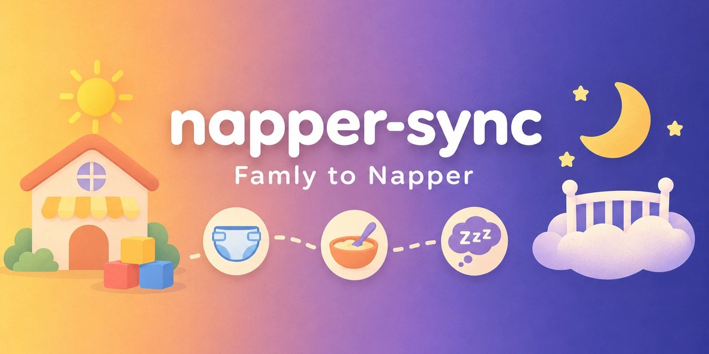

# napper-sync



**Sync what your nursery logs in [Famly](https://famly.co) - naps, meals, diaper
changes - into the [Napper](https://napper.app) baby tracker, automatically. Also an
unofficial Python client for the Napper API.**

[](https://github.com/PW-CODING/napper-sync/actions/workflows/ci.yml)
[](https://pypi.org/project/napper-sync/)


**Auf Deutsch:** Überträgt automatisch, was die Kita in Famly einträgt - Schlaf, Mahlzeiten
und Windelwechsel - in die Baby-App Napper. Kein Abtippen am Abend, keine Duplikate, und
nachträgliche Korrekturen der Kita werden übernommen. Läuft per Zeitplan auf einem
Raspberry Pi oder jedem anderen Rechner und braucht nur die Python-Standardbibliothek.
Die Dokumentation ist englisch, Fragen und Issues gern auch auf Deutsch.

Napper is a sleep-and-care tracker for babies. Famly is the app many nurseries
use to tell parents what happened during the day. If your child is in a
Famly nursery and you track at home with Napper, you end up typing the
nursery's entries into Napper by hand every evening. This tool does that for
you, every hour, without creating duplicates.

Along the way it documents two APIs that have no public documentation - see
[`docs/`](https://github.com/PW-CODING/napper-sync/tree/main/docs).

> **Disclaimer.** This project is not affiliated with, endorsed by, or supported by
> Napper AB or Famly ApS. It talks to private, undocumented APIs that the official
> apps use internally. Those APIs may change or disappear with any app update, and
> using them may not be covered by the services' terms - check the terms that apply
> to your account before you decide. Use it with your own account, for your own
> child, at your own risk; how you use it is your responsibility.

## What it does

- **Napper API client** - log in with the e-mailed one-time code, read the
  history, write and delete entries in all eleven categories Napper knows
  (nap, bedtime, woke up, night waking, nursing, bottle, solids, pumping,
  diaper, temperature, medicine), with field validation before anything is sent.
- **Famly → Napper sync** - reads the nursery's daily events and creates the
  matching Napper entries, marked `(Famly)` so you can tell them apart. When
  the nursery corrects an entry later, the Napper entry follows.
- **Safe by default** - every write is a dry run unless you pass `--live`;
  duplicate detection makes repeated runs harmless; the Napper rate limit is
  handled with back-off.
- **File import** - CSV or JSON for anything else you want to get into Napper.
- **Unattended operation** - systemd timer, Discord notifications on failure
  and on successful imports, tokens refreshed automatically.

Standard library only; no runtime dependencies.

## Install

```bash
pipx install napper-sync
# or
pip install --user napper-sync
```

Requires Python 3.11+.

## Quick start

```bash
napper-sync login you@example.com     # Napper e-mails a code; paste it
napper-sync babies                    # find your baby's ID
napper-sync config init               # write ~/.config/napper-sync/config.toml
#   -> put the baby ID into [napper] baby_id

napper-sync logs 2026-09-01 2026-09-07          # read a week
napper-sync add nap 2026-09-18T13:00 2026-09-18T14:20          # dry run
napper-sync add nap 2026-09-18T13:00 2026-09-18T14:20 --live   # write
napper-sync add diaper 2026-09-18T15:30 --set diaperContent=WET --live
napper-sync add medicine 2026-09-18T19:00 --comment "Vitamin D" --live
napper-sync categories                # every category, field and allowed value
```

### Famly sync

```bash
napper-sync famly token <VALUE>       # from localStorage["famly.accessToken"] in a logged-in browser
napper-sync famly children            # -> [famly] child_id in the config
napper-sync famly calendar 2026-09-14 2026-09-18    # what the nursery logged

napper-sync sync-famly                # dry run: shows what would be written
napper-sync sync-famly --live         # write it
```

To run this hourly on a Raspberry Pi with Discord alerts, see
[`docs/deployment.md`](https://github.com/PW-CODING/napper-sync/blob/main/docs/deployment.md).

### Importing a file

```bash
napper-sync sync-file entries.csv --live
```

Columns `start,end,category,comment` plus any category field as a further
column; see [`examples/entries.example.csv`](https://github.com/PW-CODING/napper-sync/blob/main/examples/entries.example.csv).
An optional `id` column pins the Napper ID, so importing a corrected file
updates the entries instead of duplicating them.
Categories accept English or German short names (`nap`/`nickerchen`,
`diaper`/`windel`, `bottle`/`flasche`, …).

## How it stays safe

| Risk | Answer |
|---|---|
| Writing by accident | every write and delete is a dry run without `--live` |
| Duplicates from repeated runs | Famly entries get a stable ID derived from child, category and start, so a repeated run rewrites the same entry instead of adding one; entries without such an ID, such as older imports and hand-made entries, are matched by time: a new entry is skipped if the same category is already there within 10 minutes or overlaps; day markers are one-per-day |
| Corrections at the nursery | a changed end time, note or diaper content overwrites the Napper entry on the next run; fields added by hand in the app are kept, but the comment belongs to the nursery entry and is reset if you edit it |
| Hammering the API | 429 responses are parsed and retried with the server's requested delay, up to 60 seconds; a longer demand ends the run with an error instead of blocking it |
| Bad data | field names, enum values and ranges are validated locally before a request is built |
| Silent breakage | Discord message on expired token, failed write, crashed run; unknown Famly event types are listed, never dropped |

### Known limits

- A nap that is still running at the nursery has no end yet. It is reported as still running and
  imported by the first run after it ends.
- If the nursery moves the start time of an entry, Napper sees a new event. A nap whose new time
  overlaps the old one is left alone and the old entry stays as it is. A moved meal or diaper change
  appears as a second entry next to the old one.
- Entries deleted at the nursery are not deleted in Napper.
- Before the Napper login is renewed, the token file is checked for write access. If it cannot be
  written, the run stops with an error and the stored login stays usable once the file is writable
  again. A failure the check cannot foresee, such as a full disk, still loses the renewed token,
  and a new login is needed. See the
  [deployment guide](https://github.com/PW-CODING/napper-sync/blob/main/docs/deployment.md).

## Project layout

```
src/napper_sync/
  napper.py          Napper API client (auth, read, write, delete)
  categories.py      what each category expects - the data model
  sync.py            Entry, duplicate detection, the sync loop
  sources.py         CSV / JSON sources
  famly.py           Famly API client
  famly_mapping.py   Famly events -> Napper entries
  notify.py          Discord webhook
  config.py          ~/.config/napper-sync/
  cli.py             the napper-sync command
tools/               research scripts: analyse history, rediscover endpoints, round-trip and correction checks
examples/            config, data files, systemd units, Windows task
docs/                what is known about both APIs, and how to deploy
tests/               pytest suite against an in-process mock of the Napper API
```

## Documentation

- [docs/napper-api.md](https://github.com/PW-CODING/napper-sync/blob/main/docs/napper-api.md) - endpoints, auth, the log object,
  all categories and fields, the traps (seconds in a field called minutes,
  percent-encoded comments, date-based IDs), and how the write path was found
- [docs/famly-api.md](https://github.com/PW-CODING/napper-sync/blob/main/docs/famly-api.md) - instances, token, the calendar
  endpoint and its event shapes
- [docs/deployment.md](https://github.com/PW-CODING/napper-sync/blob/main/docs/deployment.md) - systemd timer, hardening, Discord

## Development

```bash
git clone https://github.com/PW-CODING/napper-sync && cd napper-sync
pip install -e ".[dev]"
pytest
ruff check . && ruff format --check .
```

The tests run against an in-process HTTP mock that reproduces the real API's
quirks (whole-day responses on write, 429 throttling, token refresh). Nothing
touches a real account.

Tools under `tools/` do talk to the real API and are meant for the day an app
update breaks something: `probe_write_path.py` rediscovers the write endpoint,
`roundtrip_categories.py` writes one entry per category far in the past,
checks it and deletes it again, `analyze_categories.py` summarises which
fields your own history actually uses, and `probe_corrections.py` checks that
a correction made later at the nursery updates the Napper entry in place.

## Contributing

Issues and pull requests are welcome, in English or German. If an app update
changed something, the most useful report includes the output of
`tools/roundtrip_categories.py` or of `napper-sync famly calendar` for a day
with the new event type (with names and IDs removed).

## Related projects

Community projects around the same two apps, none of which connects them:

- [home-assistant-napper](https://github.com/g-nogueira/home-assistant-napper) -
  read-only Napper integration for Home Assistant
- [ha-napper](https://github.com/bbruenings/ha-napper) - another Home Assistant
  integration for Napper
- [napper-export](https://github.com/brittraee/napper-export) - export a child's
  complete Napper history
- [famly-fetch](https://github.com/jacobbunk/famly-fetch) - download your child's
  photos from Famly

## Acknowledgements

Reading the Napper API was first worked out by
[brittraee/napper-export](https://github.com/brittraee/napper-export) and
[g-nogueira/home-assistant-napper](https://github.com/g-nogueira/home-assistant-napper);
the OTP login flow and request headers here follow their findings. Writing,
deleting, the category model and the Famly side were worked out for this
project.

## License

[MIT](https://github.com/PW-CODING/napper-sync/blob/main/LICENSE)
